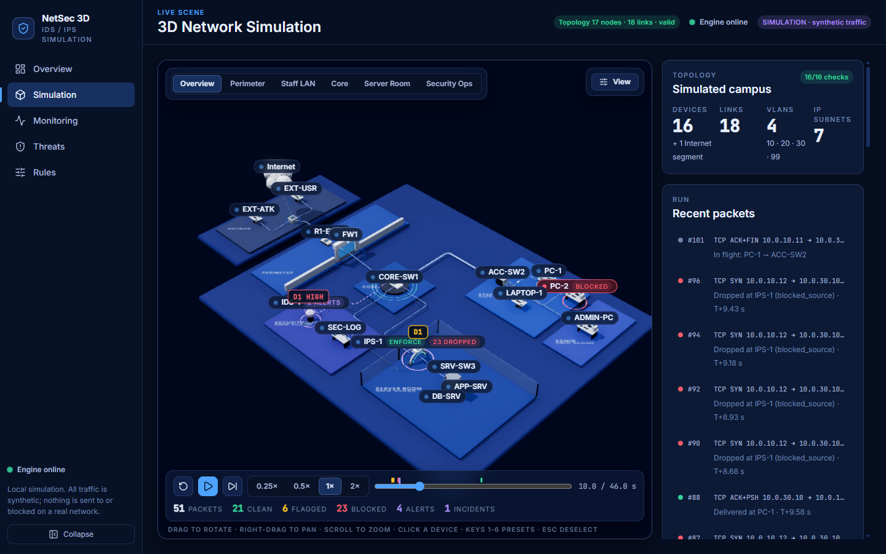
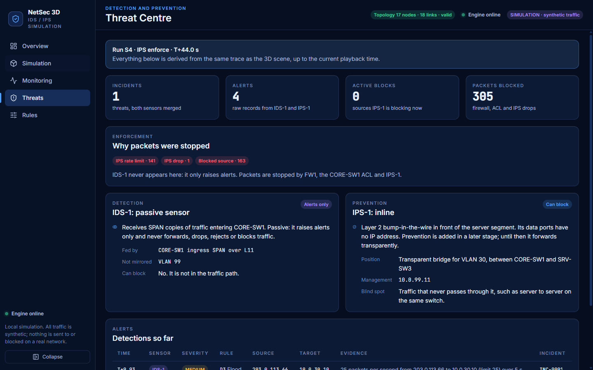
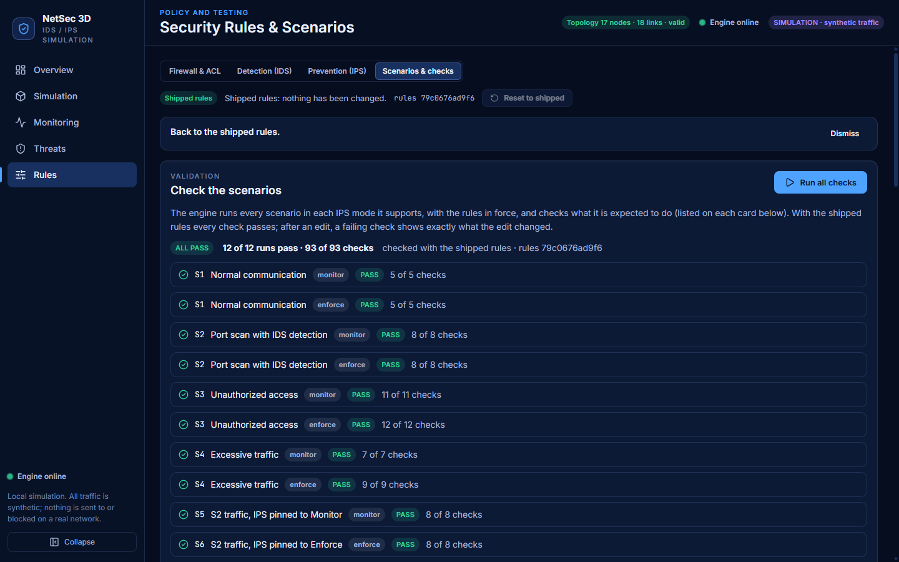

# NetSec 3D

**An interactive 3D simulation of network security: a firewall, a passive IDS and an inline IPS defending a small campus network.**

A Python engine decides what happens to every packet and writes a time-stamped trace. A React and Three.js front end replays that
trace as packets travelling along cables through a 3D campus, so you can watch a port scan get detected, mirrored, flagged
and blocked, and see exactly which device made each decision.



> **Everything is synthetic.** No real traffic is captured, sent, scanned or blocked. "Blocking" only changes the state of the
> simulation. The firewall, ACL, IDS and IPS are models of the concepts, not Cisco IOS, Snort or Suricata, and detection is
> rule and threshold based (no machine learning).

## What it shows

- **A frozen, validated topology:** 16 devices plus an abstract Internet segment, 18 links, 4 VLANs and 7 IP subnets
  (`docs/NETWORK_TOPOLOGY.md`). A validator checks it with 16 rules.
- **Defence in depth with honest roles:**
  - **FW1** and the **CORE-SW1 ACL** enforce static policy, whatever the IPS mode.
  - **IDS-1 is passive.** It only receives SPAN copies of traffic and raises alerts. It never forwards, drops or blocks.
  - **IPS-1 is inline** (a transparent bridge on the server VLAN) and is the only sensor that can enforce. In **Monitor** mode it
    records what it would do; in **Enforce** mode it drops, rejects, rate-limits or blocks a source.
- **Seven scenarios** (normal traffic, port scan, unauthorised access, flood, SSH brute force, and the same scan with the IPS in
  Monitor and Enforce mode), each with declared expectations that are checked automatically (93 checks).
- **Six detectors** (D1 to D6) with sliding windows, correlated into incidents across IDS-1 and IPS-1.
- **Deterministic by design.** The same seed gives the same trace. Mid-run changes (IPS mode, detector switches, your own
  injected packets) re-simulate from the playhead and leave everything before it identical.
- **Five pages:** Overview, 3D Simulation, Monitoring, Threat Centre, and a Rules and Scenarios editor with Cisco IOS export of the
  firewall and ACL policy.

| Threat Centre | Rules and scenario checks |
|---|---|
|  |  |

## How it works

```
backend (FastAPI)                         frontend (React + Three.js)
  topology.json  ──►  discrete-event  ──►  trace (events)  ──►  player  ──►  3D scene, tables, counters
  policies, rules     engine                (time-stamped)       (replay)       (everything derives from the trace)
```

The backend decides every packet's fate and the frontend never does, so the 3D effects, counters and tables cannot disagree.
More detail: `docs/ARCHITECTURE.md` and `docs/SECURITY_ENGINE.md`.

## Run it locally

Requirements: Python 3.12 or newer (developed on 3.13), Node.js 20.19 or newer (developed on 24), and a current Chromium-based
browser with WebGL 2.

Windows scripts are provided today (cross-platform setup is the first planned improvement, see the roadmap):

```
scripts\setup.cmd           first time only, needs the internet: virtual environment, dependencies, production build
scripts\verify.cmd          optional: backend tests, the 93 scenario checks, frontend tests and the production build
scripts\start-demo.cmd      one process serves the API and the built front end at http://127.0.0.1:8000/simulation
scripts\start-dev.cmd       backend on :8000 plus the Vite dev server on http://127.0.0.1:5173 (hot reload)
```

By hand:

```
cd backend  && python -m venv .venv && .venv\Scripts\python -m pip install -r requirements.txt
cd frontend && npm ci && npm run build
cd backend  && .venv\Scripts\python app.py        # http://127.0.0.1:8000, API docs at /docs
```

The backend binds to a loopback address only and refuses anything else, on purpose. After setup the app makes no request to
any other host.

## Tests

```
cd backend  && .venv\Scripts\python -m pytest
cd frontend && npx vitest run
```

The release record for v1.0 (937 backend tests, 277 frontend tests, 93 of 93 scenario checks, production build, browser
rehearsal) is in `docs/STAGE7_PROGRESS.md`, together with what was **not** verified. Notably, the 55 fps target on a discrete
GPU was never measured, and a second laptop was never tested. See `docs/LIMITATIONS.md` for the full, unsoftened list.

## Repository layout

| Path | Purpose |
|---|---|
| `backend/` | FastAPI engine: topology, routing, simulation, security, shipped configuration, tests |
| `frontend/` | React, Vite and Three.js app (`src/scene` 3D, `src/playback` replay, `src/pages`, `src/features`, `src/state`) |
| `contracts/` | The frozen trace event schema shared by both sides |
| `scripts/` | Setup, start and verify scripts; real-browser rehearsal and measurement tools |
| `docs/` | Architecture, topology, API, security engine, limitations, screenshots and the stage records |

## Status and roadmap

`v1.0` is the first complete release of the simulation. Further work happens on the `develop` branch:

1. Cross-platform setup and continuous integration.
2. Deployment readiness (explicit production configuration, secure CORS, read-only shared rules).
3. 3D interactivity: stronger selection feedback, double-click focus, cable inspection.
4. A pop-out viewer for inspecting a single device model.
5. An optional, decorative campus-expansion preview.

The network topology and the security behaviour are frozen: visual work must not change simulation results.

## Branches and contributions

`main` is stable and release-ready, `develop` integrates approved work, and each feature lives on a `feature/*` branch.
Only tested, approved changes reach `main`. The full process will be described in `CONTRIBUTING.md`.

## Development note

The project began as a five-student Computer Networks course project. The code, tests and documentation were written with an AI
coding assistant (Claude Code) working on the team's instructions. `docs/TEAM.md` says plainly what the repository can and
cannot show about individual contributions.

## Licence

No licence has been chosen yet. Until one is added to this repository, all rights are reserved by the authors.
