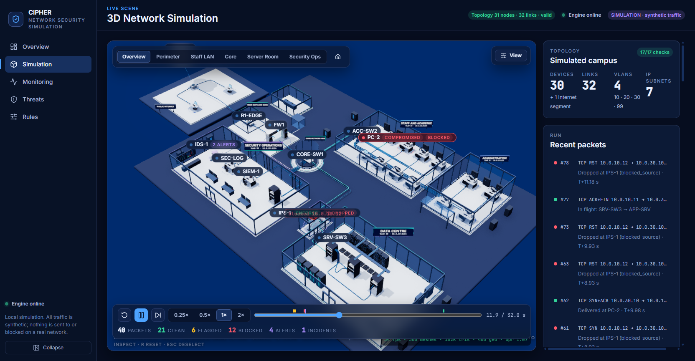
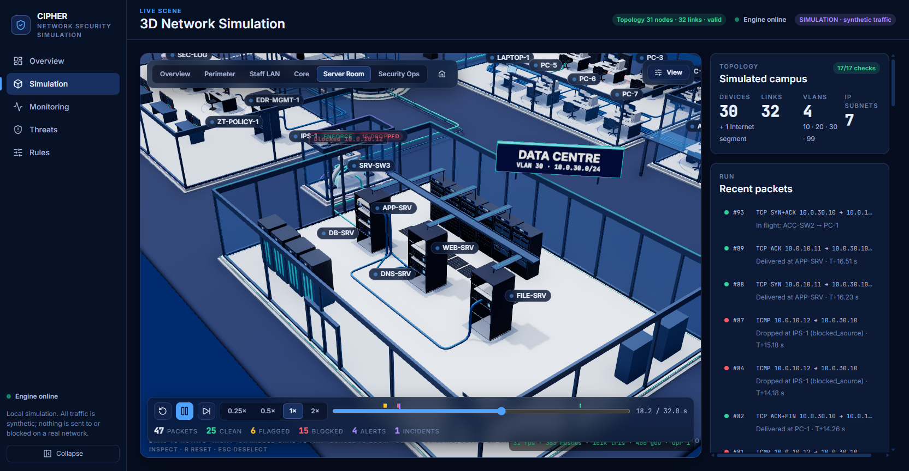
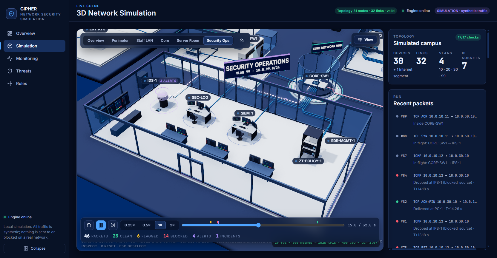
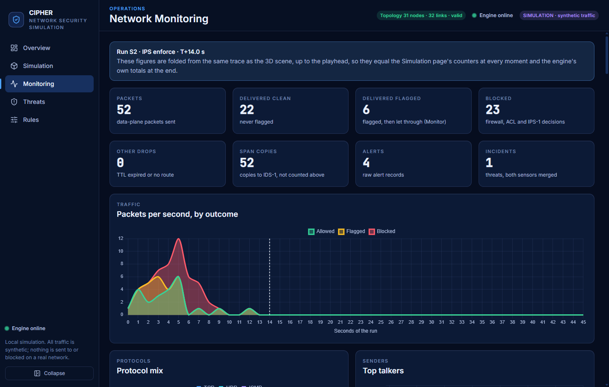
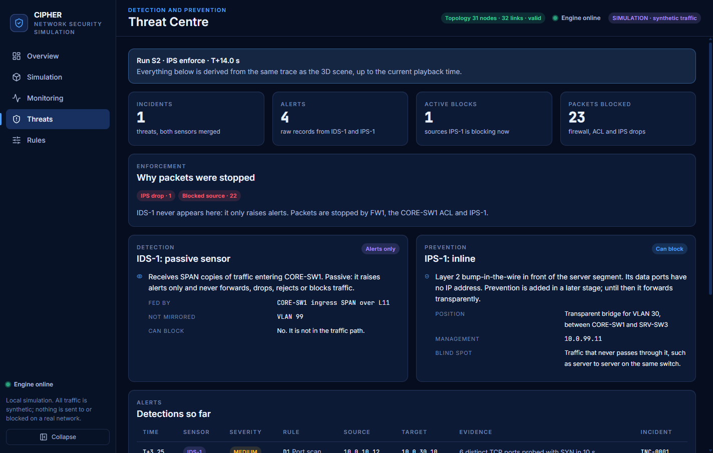
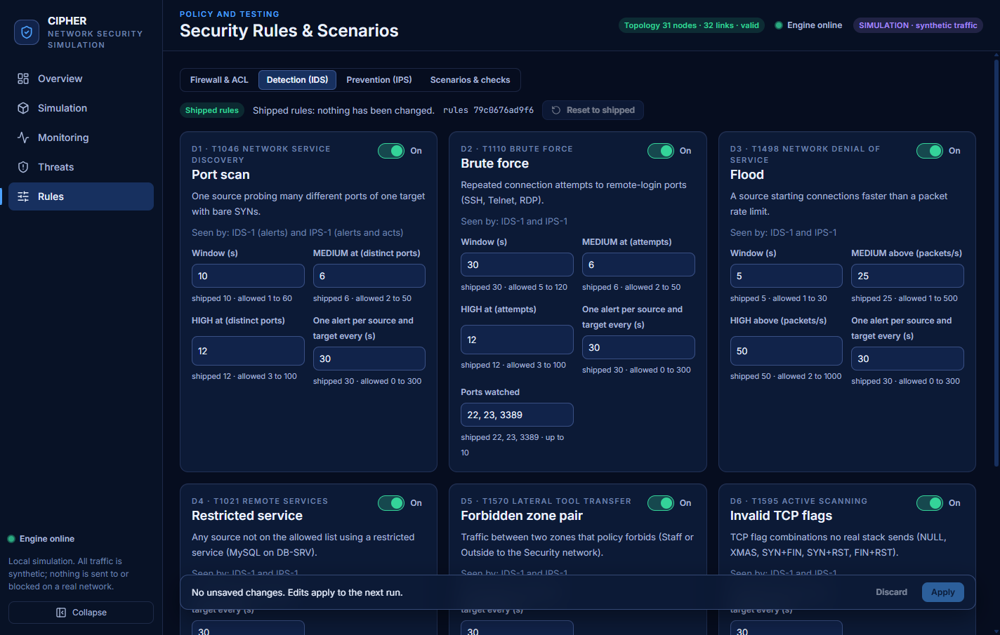

# CIPHER

**CIPHER** is an interactive 3D simulation of network security: a firewall, a passive IDS and an inline IPS defending a small
campus network. You can watch a port scan get detected, mirrored, flagged and blocked, and see exactly which device made each
decision.

> CIPHER is the project's official name (formerly NetSec 3D). Technical identifiers keep their original names so that nothing
> breaks: the Python package `netsec`, the `NETSEC_*` environment variables, the health-check service name `netsec-ids-engine`,
> the `window.__netsec*` debug handles and the repository folder.



> **Everything is synthetic.** No real traffic is captured, sent, scanned or blocked. "Blocking" only changes the state of the
> simulation. The firewall, ACL, IDS, IPS, Zero Trust, SIEM and EDR are models of the concepts, not Cisco IOS, Snort, Suricata or
> a commercial product, and detection is rule and threshold based (no machine learning).

**New to CIPHER?** Read the user manual: [docs/CIPHER_USER_MANUAL.md](docs/CIPHER_USER_MANUAL.md). It explains every page, security
tool, rule, scenario and chart in plain language, with examples.

## Contents

1. [Overview and objectives](#overview-and-objectives)
2. [Key features and security capabilities](#key-features-and-security-capabilities)
3. [Technology stack](#technology-stack)
4. [Architecture](#architecture)
5. [Installation and setup](#installation-and-setup)
6. [Running the backend and the frontend](#running-the-backend-and-the-frontend)
7. [Using the simulation](#using-the-simulation)
8. [Testing and verification](#testing-and-verification)
9. [Screenshots](#screenshots)
10. [Limitations and future enhancements](#limitations-and-future-enhancements)
11. [Hosting, repository layout and contributions](#hosting)

## Overview and objectives

CIPHER was built as a Computer Networks course project. It teaches how layered network defences work together, and makes the
invisible visible: every packet is a coloured envelope travelling along a real cable through a 3D campus, and every device that
touches it records a decision you can inspect.

Objectives:

- Show **defence in depth**: a stateful firewall, a core ACL, a passive IDS, an inline IPS, Zero Trust policy and endpoint
  isolation, each with an honest, distinct role.
- Make detection and prevention **explainable**: every alert, block and drop says which rule fired, on which device, and why.
- Stay **deterministic and testable**: the same seed always gives the same trace, so scenarios can be checked automatically.
- Run **offline on one laptop**, with no database, cloud service or account.

## Key features and security capabilities

- **A validated campus.** 30 devices plus an abstract Internet segment, 32 links, 4 VLANs, 7 IP subnets and 7 zones. A validator
  checks the topology against 17 rules ([docs/NETWORK_TOPOLOGY.md](docs/NETWORK_TOPOLOGY.md)).
- **Defence in depth with honest roles.**
  - **FW1** (stateful firewall) and the **CORE-SW1 ACL** enforce static policy whatever the IPS mode.
  - **IDS-1 is passive.** It only receives SPAN copies of traffic and raises alerts. It never forwards, drops or blocks.
  - **IPS-1 is inline** (a transparent bridge on the server VLAN) and is the only sensor that enforces on detections. In
    **Monitor** mode it records what it would do. In **Enforce** mode it drops, rejects, rate-limits or blocks a source.
- **Six detectors (D1 to D6)** with sliding windows (port scan, brute force, flood, restricted service, forbidden zone pair,
  invalid TCP flags), correlated into incidents across IDS-1 and IPS-1, each with a MITRE ATT&CK label.
- **Zero Trust, SIEM and EDR.** A policy decision point (ZT-POLICY-1) and enforcement point (CORE-SW1) give an allow or deny with
  reasons. A simulated SIEM collects alerts. An operator can **isolate** and **restore** an endpoint with EDR. An isolated endpoint
  creates no packet at all, and packets already in flight are quarantined.
- **Sixteen scenarios.** Seven original scenarios (normal traffic, port scan, unauthorised access, flood, SSH brute force, and the
  same scan with the IPS in Monitor and in Enforce mode) with 93 automated checks, plus nine presentation scenarios P1 to P9
  (Staff to Security VLAN, Staff to database, authorised administrator access, external HTTP, external database, a compromised
  endpoint and EDR isolation, recovery, SIEM monitoring).
- **Endpoint terminals.** Open a PC, laptop or server and type `ping`, `tracert`, `telnet`, `curl` or `ipconfig`. A ping is four
  sequential journeys of envelope packets along the real cables, and each `Reply from` line appears only when its reply reaches
  the source. Routers, the core switch and the firewall have a read-only `show` command line. No real shell exists.
- **A 3D campus built in code.** Glass buildings with interiors, devices with live status, cables with route glow, coloured packet
  envelopes with a green tick on delivery and a red cross on a block, a live SOC wall drawn from the trace, and a camera you can
  orbit, zoom and pan (left-drag rotates, right-drag or **middle-button drag** pans, wheel zooms).
- **Deterministic by design.** Mid-run changes (IPS mode, detector switches, your own injected packets) re-simulate from the
  playhead and leave everything before it identical.
- **Five pages.** Overview, 3D Simulation, Monitoring (counters, charts, per-device table, event log), Threat Centre (incidents
  and the SIEM console) and Rules and Scenarios (editors, scenario checks and Cisco IOS export of the firewall and ACL policy).

## Technology stack

| Layer | Technology |
|---|---|
| Backend | Python 3.12+ (developed on 3.13), FastAPI 0.162, Uvicorn 0.54, Pydantic 2.14 |
| Frontend | React 19, Vite 8, JavaScript with JSDoc types, React Router 7, Zustand 5 |
| 3D | three.js 0.187, React Three Fiber 9, drei 10, postprocessing (ambient occlusion, bloom, anti-aliasing) |
| Charts and UI | Chart.js 4 with react-chartjs-2, lucide-react icons, Inter and JetBrains Mono fonts (bundled, no CDN) |
| Tests | pytest (backend), Vitest (frontend), Chrome DevTools Protocol scripts for real-browser checks |
| Not used | Any database, WebSocket, external API, machine learning, or real packet capture |

## Architecture

```
backend (FastAPI)                         frontend (React + Three.js)
  topology.json  ──►  discrete-event  ──►  trace (events)  ──►  player  ──►  3D scene, tables, counters, charts
  policies, rules     engine                (time-stamped)       (replay)       (everything derives from the trace)
```

- A deterministic **discrete-event engine** decides the fate of every packet and writes a time-stamped **trace**. The event
  contract (`contracts/events.json`, 19 event types) is shared by both sides.
- The **frontend never decides anything.** A player replays the trace; the 3D scene, counters, tables and charts all read the
  same playhead, so a block is drawn in the same frame its counter changes.
- Static policy (FW1, ACL) is applied first, then the passive IDS inspects a mirror copy, then the inline IPS runs its detectors
  on every packet before enforcing.

More detail: [docs/ARCHITECTURE.md](docs/ARCHITECTURE.md), [docs/SECURITY_ENGINE.md](docs/SECURITY_ENGINE.md) and
[docs/API_CONTRACTS.md](docs/API_CONTRACTS.md).

## Installation and setup

Requirements: Python 3.12 or newer (developed on 3.13), Node.js 20.19 or newer (developed on 24), and a current Chromium-based
browser with WebGL 2.

One task runner (Python standard library only) does the work the same way on Windows, macOS and Linux:

```bash
python scripts/tasks.py setup     # first time only, needs the internet: virtual environment, dependencies, production build
```

`setup --runtime-only` installs only what the server needs, without the test tools. On Windows the same tasks are available as
`scripts\setup.cmd`, `scripts\verify.cmd`, `scripts\start-demo.cmd` and `scripts\start-dev.cmd`.

By hand (Windows paths shown; on macOS and Linux use `.venv/bin/python`):

```bash
cd backend  && python -m venv .venv && .venv\Scripts\python -m pip install -r requirements-dev.txt
cd frontend && npm ci && npm run build
```

> The task runner has been run on **Windows only**. It is written for macOS and Linux as well, and the continuous integration
> workflow runs the backend and frontend checks on Linux, but nothing here has been run on those systems by hand.

## Running the backend and the frontend

**Demo mode (one process, works offline).** The backend serves the API and the built front end:

```bash
python scripts/tasks.py demo      # http://127.0.0.1:8000/simulation
```

**Development mode (hot reload).** The backend on port 8000 plus the Vite dev server:

```bash
python scripts/tasks.py dev       # front end at http://127.0.0.1:5173, API docs at http://127.0.0.1:8000/docs
```

Each part can also be started alone:

```bash
cd backend  && .venv\Scripts\python app.py     # API at http://127.0.0.1:8000 (health check: /api/health)
cd frontend && npm run dev                     # Vite dev server, proxies /api to the backend
```

By default the backend binds to a loopback address only and refuses anything else, on purpose (a public deployment must opt in
explicitly, see [Hosting](#hosting)). After setup the app makes no request to any other host.

## Using the simulation

1. Open **3D Simulation**. The campus appears with an idle SOC wall.
2. In the right panel choose a **scenario**, for example *Port scan* (S2), and press play. Use the speed buttons (0.25x to 2x),
   the scrubber (alert and block marks are shown on it) and the step button to move through the run.
3. Watch the packets. A green envelope is allowed, amber is flagged, red is blocked. A tick marks a delivered ping and a cross marks
   a blocked packet, at the device that stopped it.
4. Switch the IPS between **Monitor** and **Enforce** and see the same scan behave differently. Changes re-simulate from the
   playhead.
5. **Click a device** to open its panel. For a PC, laptop or server, open its terminal and type `ping 10.0.30.10`. Press Stop or
   Ctrl+C to end a ping early.
6. Use the camera presets (Overview, Perimeter, Staff LAN, Core, Server Room, Security Ops) or move freely: drag to rotate,
   middle-button drag or right-drag to pan, wheel to zoom.
7. Visit **Monitoring** for charts (traffic over time, protocol mix, top talkers), **Threat Centre** for correlated incidents and
   the SIEM console, and **Rules** to edit the firewall, ACL, detectors and IPS policy, run all scenario checks and export Cisco
   IOS configuration.

The full walkthrough, with examples for every page, is in the [user manual](docs/CIPHER_USER_MANUAL.md).

## Testing and verification

```bash
python scripts/tasks.py verify                       # backend tests, scenario checks, frontend tests and the production build
python scripts/tasks.py verify --only backend        # or one step: backend, scenarios, frontend, build
```

Continuous integration (`.github/workflows/ci.yml`) runs the same steps on every push and pull request.

Latest verified results on the development machine (Windows 11, integrated Intel GPU):

| Check | Result |
|---|---|
| Backend tests (pytest) | 1210 passed |
| Scenario checks (S1 to S7 across the shipped rules, 12 runs) | 93 of 93 passed |
| Frontend tests (Vitest, 31 files) | 367 passed |
| Production build (Vite) | succeeds |
| Browser checks in real Chrome (Chrome DevTools Protocol) | demonstration 39 of 39, offline recovery 8 of 8, middle-button pan 13 of 13, interactions 70 of 70, split-origin 20 of 20 and 34 of 34 |

The browser checks are run with `node scripts/check_*.mjs`. The complete record, including what was **not** verified, is in
[docs/CIPHER_FINAL_TECHNICAL_REPORT.md](docs/CIPHER_FINAL_TECHNICAL_REPORT.md) (section 18) and
[docs/LIMITATIONS.md](docs/LIMITATIONS.md).

## Screenshots

| Server room and a blocked scan | Security Operations (IDS, SIEM, Zero Trust, EDR) |
|---|---|
|  |  |

| Monitoring charts | Threat Centre |
|---|---|
|  |  |

| Rules and scenario editor |
|---|
|  |

## Limitations and future enhancements

Known limitations (the full, unsoftened list is [docs/LIMITATIONS.md](docs/LIMITATIONS.md)):

- **Performance.** On an Intel integrated GPU the High quality preset reaches about 26 fps in the idle overview and 31 to 33 fps in
  other views, and the Low preset runs at 60 fps. The 55 fps target on a discrete GPU was never measured.
- **Visual density.** Building interiors and device models are procedural and simpler than a hand-modelled scene.
- **Scope of the models.** Everything is simulated and rule based. There is no real packet capture, no machine learning and no
  real shell.
- **Platforms.** Only Windows was exercised by hand. A second laptop was never tested.
- **Not deployed.** A Render deployment is configured but nothing is hosted.

Future enhancements:

- Host-sweep detection (D7) and PCAP export with a hex view.
- A follow-packet camera and syslog packets drawn on the way to the SIEM.
- A Cisco Packet Tracer lab that mirrors the topology, with a parity table against the app.
- Denser building interiors and higher-detail device models.
- Updated presentation slides, and a tested macOS and Linux setup.

## Hosting

The repository is prepared for a free [Render](https://render.com) deployment: a static site for the front end and a Python web
service for the API (`render.yaml`). **Nothing is deployed yet**, and the configuration has been tested only locally, including a
simulation of the two-origin layout. A public deployment is locked down by default: the backend stays loopback-only unless
`NETSEC_ENV=production` and an explicit public-bind flag are both set, the rules are read-only (they are shared by every
visitor), API docs are off, requests are size-limited and rate-limited, and only the front end's origin may call the API. See
[docs/DEPLOYMENT_RENDER.md](docs/DEPLOYMENT_RENDER.md).

## Repository layout

| Path | Purpose |
|---|---|
| `backend/` | FastAPI engine: topology, routing, simulation, security, shipped configuration, tests |
| `frontend/` | React, Vite and Three.js app (`src/scene` 3D, `src/playback` replay, `src/pages`, `src/features`, `src/state`) |
| `contracts/` | The trace event schema shared by both sides |
| `scripts/` | Task runner, setup and start scripts, real-browser checks and measurement tools |
| `docs/` | User manual, architecture, topology, API, security engine, limitations, report, screenshots and stage records |

## Branches and contributions

`main` is stable and release-ready, `develop` integrates approved work, and each feature lives on a `feature/*` branch. Only
tested, approved changes reach `main`. The process is described in [CONTRIBUTING.md](CONTRIBUTING.md), and the commands,
dependency files and CI in [docs/DEVELOPMENT.md](docs/DEVELOPMENT.md).

## Development note

The project began as a five-student Computer Networks course project. The code, tests and documentation were written with an AI
coding assistant (Claude Code) working on the team's instructions. [docs/TEAM.md](docs/TEAM.md) says plainly what the repository
can and cannot show about individual contributions.

## Licence

No licence has been chosen yet. Until one is added to this repository, all rights are reserved by the authors.
