# C2.1, C3, C4 and Stage D: consolidated implementation record

Branch `feature/campus-c1-design`, on top of C2 (`03ab02c`). Not merged, not pushed, not deployed, `main` untouched.

All four work packages were implemented first and verified once at the end (see "Verification"). Nothing in the logical network changed: 17 nodes, 18 links, VLANs 10/20/30/99, addressing, routing, ACLs, firewall, IDS and IPS behaviour, scenarios, trace generation, device positions, cable routes and campus building positions and sizes are as before. The layout fingerprint test still passes, and all 12 scenario trace hashes are identical to `docs/DEVELOPMENT.md`.

## What was built

### C2.1 Visual contrast
- **Cables** are cyan and teal (`#22b9d4` access/ethernet, `#4fd8ee` trunk, muted teal for management; the SPAN cable stays violet). Each cable has its own material. While it carries flagged traffic it moves part of the way to amber, for blocked traffic to red, with a low glow so it never blooms (`links/linkActivity.js`, filled by `PacketLayer` once per frame, no React state).
- **Packets** are about 40% larger than before (a cable is 0.04 thick), and the neutral colour is brighter. Colours and verdict semantics are unchanged.
- **Platforms** keep the approved pale tops. Darker blue-grey mounting pads under every free-standing device (one pad for the rack) plus a soft contact shadow under each, in one draw call each (`campusLayout.devicePads`, `campusMeshes`).
- **Signs**: 20% larger, darker plate, heavier text; same raised placement.
- Device model geometry is untouched.

### C3 Campus zone interactions
- Invisible pick volumes over every pavilion (`CampusInteraction.jsx`, no draw calls). Hover: subtle floor tint and outline of the pavilion, zone name as the canvas tooltip, pointer cursor. Click: selects the zone, highlights its pavilion, shows the zone panel (purpose, VLAN and subnet, the approved devices), highlights those devices with a floor ring and dims the other zones (a slight veil on their platforms, their labels at 55%; nothing is hidden).
- Mapping is the approved one: Staff PC-1, PC-2, LAPTOP-1, ACC-SW2; Administration ADMIN-PC; Data Centre APP-SRV, DB-SRV, SRV-SW3; Security Operations IDS-1, IPS-1, SEC-LOG. Core, Main Gate and Edge, and Public Internet are selectable too, so each of the 17 nodes is in exactly one zone. IPS-1 stays where it is; its pavilion is part of Security Operations.
- Double-click a zone: selects it and flies the camera there. The Home button, key R and the Overview preset return to the overview.
- Deselect is layered: clicking empty ground clears the zone; with no zone selected it clears the selected device, cable or packet as an empty click always did; Esc and a click in the void clear everything. A device selected on its own is never cleared by the click that clears a zone.
- State: separate slices `zone`, `cable`, `inspectorId` next to the existing `selection` (device and packet). A zone never clears a device and the reverse. A cable, a device and a packet exclude each other, as a device and a packet always did.

### C4 Device, cable and camera polish
- **Picking priority** (`scene/picking.js`): packet, then device, then cable, then zone, then ground. A device inside a glass pavilion, a cable crossing a pavilion, or a packet passing a device is always picked before the invisible volume around it. Device hit boxes are no longer drawn at all (they were transparent meshes), which removes draw calls.
- **Devices**: hover keeps the lift, ring and box frame; a selected device shows its own silhouette as a postprocessing outline in High (Low keeps the box frame). `DevicePanel`, `DeviceList` and `PacketPanel` are unchanged apart from the Inspect and Cable buttons.
- **Cables are selectable**: an invisible 0.2 radius tube follows each route. Hover brightens, selection lights the cable, adds a soft halo and rings its two devices; the cable panel shows the link id, kind and VLANs, and the source and destination with interface and address, all from topology data. Click again, the X button or Esc deselects. The device panel lists each connection with a "Cable Lxx" button; the cable `L04` runs behind the firewall gate model and cannot be clicked in the default view, so that button is the way to select it (17 of 18 cables are clicked directly).
- **Camera**: smoother moves (smoothing 0.45), zone focus request, reset button, keys R, Home and 0. Presets and limits (9 to 125) unchanged.

### Stage D Separate 3D device viewer
- A dialog with its own canvas, camera and info panel (`features/simulation/DeviceInspector.jsx`, `scene/inspector/`). It draws the same `MODELS[key]` components on a pedestal of the campus platform material; no second set of models. Rotate with the mouse, scroll to zoom, right-drag to pan, Reset camera, previous/next device, Close. Shows name, model name and key, type, zone, address, interfaces, services and neighbours.
- Open with: the Inspect button, double-clicking a device, key I. Esc closes. Double-click on a device opens the viewer; double-click on the pavilion itself focuses the zone; the two never overlap because a device on the ray wins.
- The viewer is lazy-loaded and mounted only while open: closing it unmounts its Canvas, which releases its WebGL context. It never touches the campus camera, selection of packets or playback. The viewer works in High (outline-capable PostFX, shadows) and Low.
- All 12 model keys are named and framed (`scene/inspector/modelInfo.js`), and each is covered by one of the 17 nodes.

## Fixes found on the way
- An effect returned a promise (`setLookAt`), which React treated as a cleanup function (37 console errors per viewer session). Fixed.
- The scene statistic counted never-drawn pick volumes as meshes; it now skips meshes whose material is invisible, so `meshes` is again the true draw count.

## Verification (run once, at the end)
| Check | Result |
|---|---|
| Backend tests | 1068 passed |
| Scenario checks | 12 of 12 runs, 93 of 93 checks, all 12 trace hashes identical to `docs/DEVELOPMENT.md` |
| Frontend tests | 335 passed (307 before plus 28 new: picking, link activity, zone and cable data, store slices, viewer model coverage) |
| Production build | passes |
| Split-origin check | 20 of 20, rehearsal 34 of 34, no CSP or console errors |
| Offline recovery | 8 of 8 |
| Real-browser interaction checks (`scripts/check_interactions.mjs`) | 70 of 70, no console errors, no request left 127.0.0.1 |

The 70 interaction checks run in real Chrome with real mouse events, in High and again in Low: all 17 devices hover and select by click (also inside the pavilions) and never select their zone; all 7 zones hover and select; each zone highlights exactly its approved devices and dims the rest; device and zone selection do not conflict; the layered ground click; double-click zone focus (camera moves 38 units) and R back to the overview (0.00 units off); all 18 cables selectable with the correct source and destination and interfaces; the viewer opens by double-click, button and key; all 12 model keys open and draw; drag rotates, scroll zooms, Reset returns to the first view (0.000 off); closing leaves the campus camera exactly where it was; the playhead kept running (3.0 s to 44 s) while the viewer was used; the campus renderer holds the same geometries after the viewer closes; 20 open/close cycles leave only the campus canvas and produce no WebGL context warnings.

## Performance (S4 flood peak, Enforce, 1904 x 985, Intel laptop)
| | C2 (`03ab02c`) | Now |
|---|---|---|
| Draw calls | 217 to 219 | 202 to 203 |
| Triangles | about 80.4k | about 80.4k |
| High fps | 22.7, 22.5 (same session) | 22.7, 22.9 |
| Low fps | 53.5 to 56.7, mean 54.5 (same session) | 53.1 to 56.1, mean 55.0 |
| Textures High / Low | 54 / 28 | 59 / 29 |
| Geometries | 157 | 186 |

C2 and the new build were run alternately in the same session, so they are comparable with each other. This session's absolute Low numbers are about 5 fps below the earlier 59 to 60 fps readings, so I read them as machine load, not as a change in the build; C2 and the new build are equal within noise. High is equal. The RTX 4050 55 fps target has not been measured on that GPU and is not claimed.

## Known limits and notes
- Cable `L04` is hidden behind the firewall model from the default angle; it is selected from the device panel's Cable button.
- A selected zone dims the other labels to 55%, readable but quieter. Dimming the floor is a veil on platform tops only.
- The viewer and the campus both render while it is open (the campus must keep animating packets). On a slow GPU the viewer slows the campus a little while open; it costs nothing when closed.
- The postprocessing outline needs High; Low shows the box frame.
- CSP is unchanged. `script-src 'self' blob:` could be tightened later, since the troika text worker is gone.
- Earlier open points are unchanged: noreply email not confirmed, no licence chosen, Linux/macOS/GitHub Actions/Render untested.

## Files
Added: `frontend/src/scene/picking.js` (+test), `scene/cableInfo.js`, `scene/campus/CampusInteraction.jsx`, `scene/campus/campusInteraction.test.js`, `scene/links/linkActivity.js` (+test), `scene/inspector/` (`InspectorCanvas.jsx`, `modelInfo.js`, `modelInfo.test.js`), `features/simulation/ZonePanel.jsx`, `CablePanel.jsx`, `DeviceInspector.jsx`, `state/interaction.test.js`, `scripts/check_interactions.mjs`, `docs/design/campus-c3/` (screens and perf output), this record.
Modified: `state/store.js`, `scene/SceneCanvas.jsx`, `PostFX.jsx`, `CameraRig.jsx`, `SceneStats.jsx`, `palette.js`, `materials/materials.js`, `packets/PacketLayer.jsx`, `links/NetworkLinks.jsx`, `links/linkPaths.js`, `devices/DeviceNode.jsx`, `campus/CampusWorld.jsx`, `campusLayout.js`, `campusMaterials.js`, `campusMeshes.js`, `scene/scene.css`, `features/simulation/DevicePanel.jsx`, `SimulationViewport.jsx`, `simulation.css`, `pages/NetworkSimulation.jsx`, `scripts/lib/cdp.mjs`.

## Screenshots (real application)
Campus interaction: 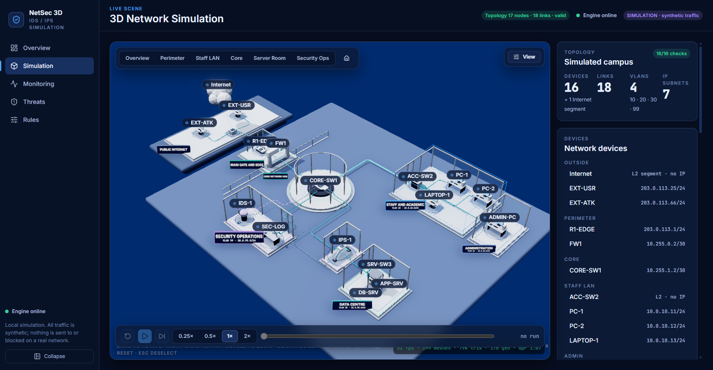   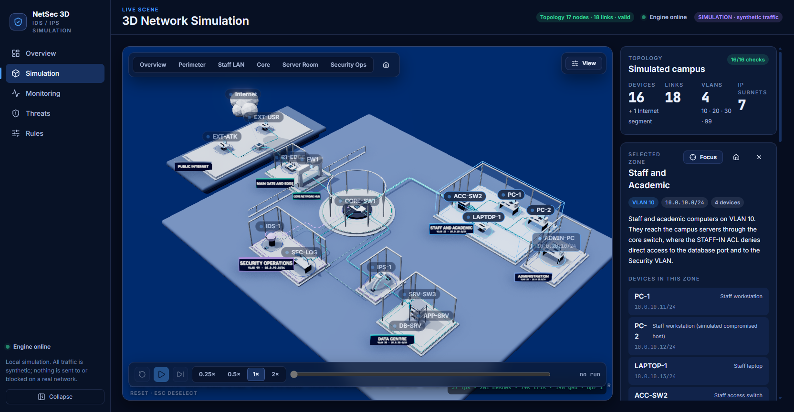 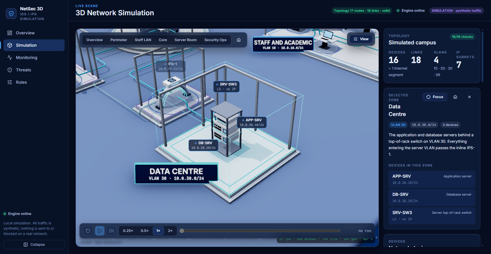
Cable selection: 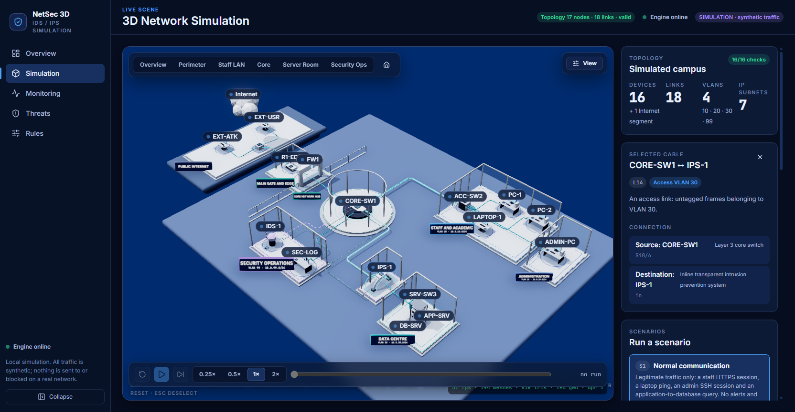
Device viewer: 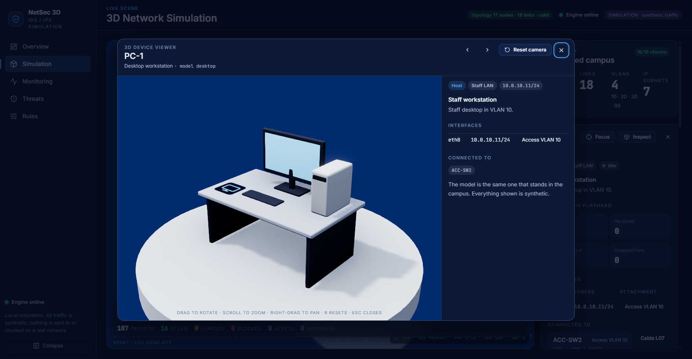 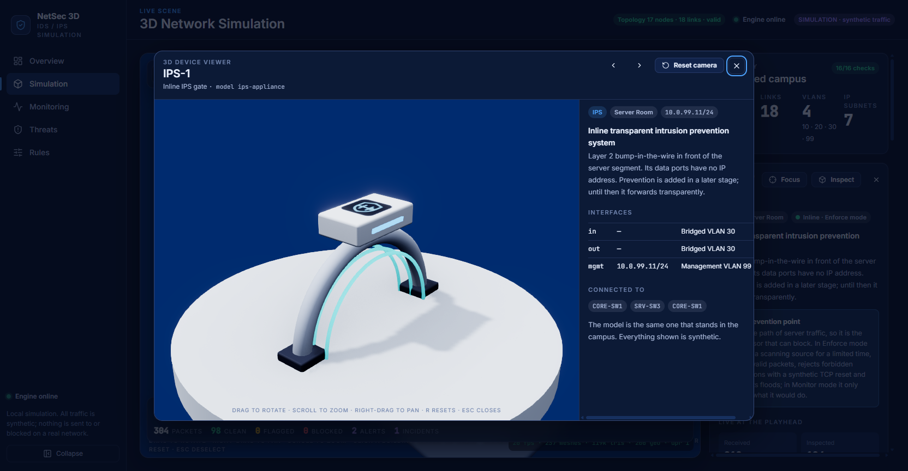 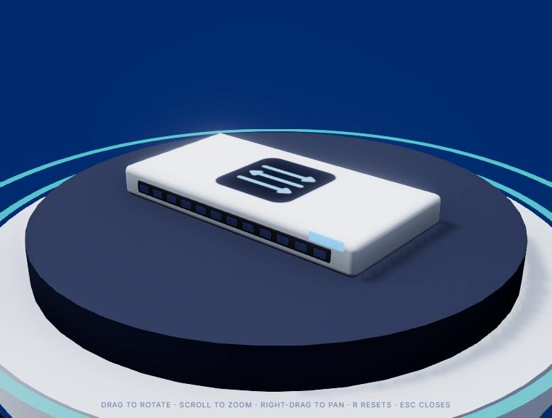 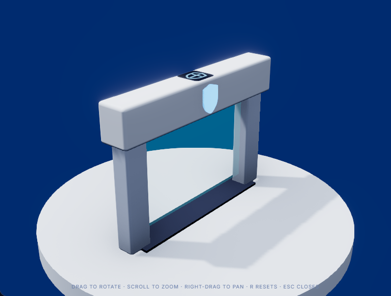 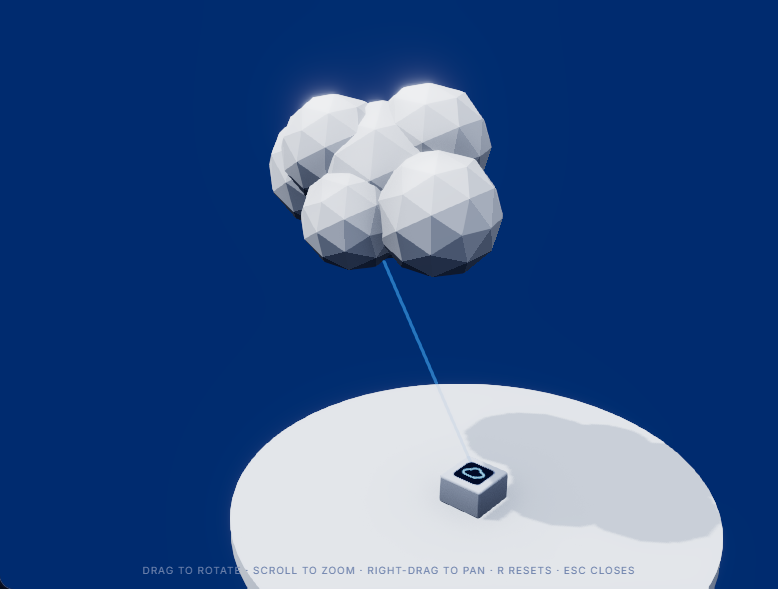 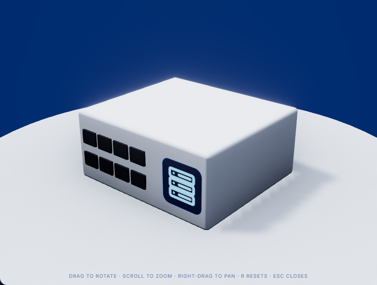 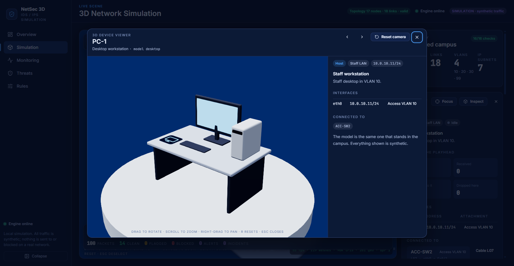
Contrast and packets: 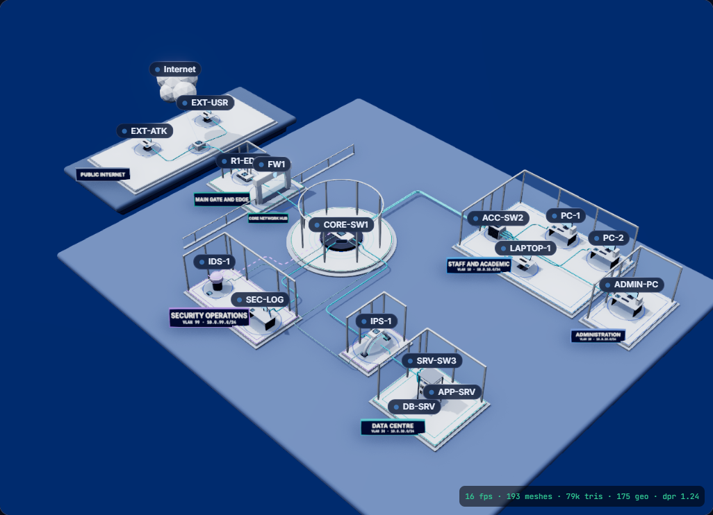 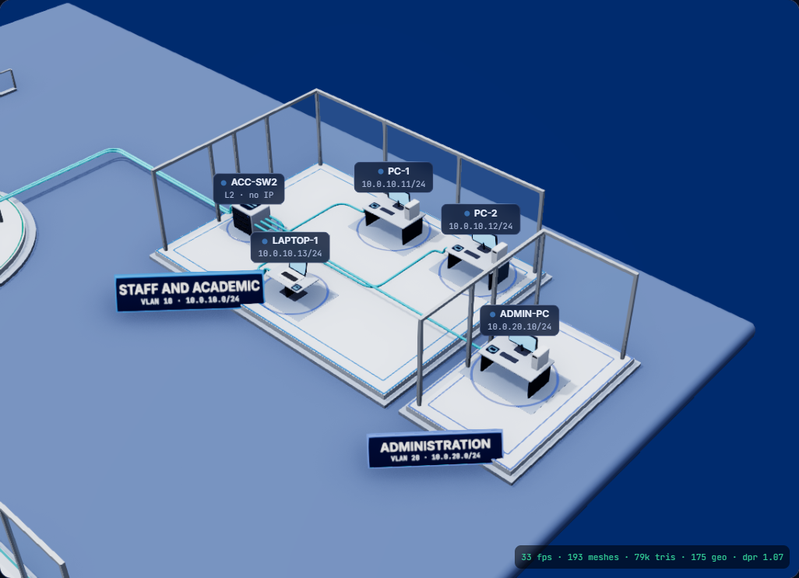 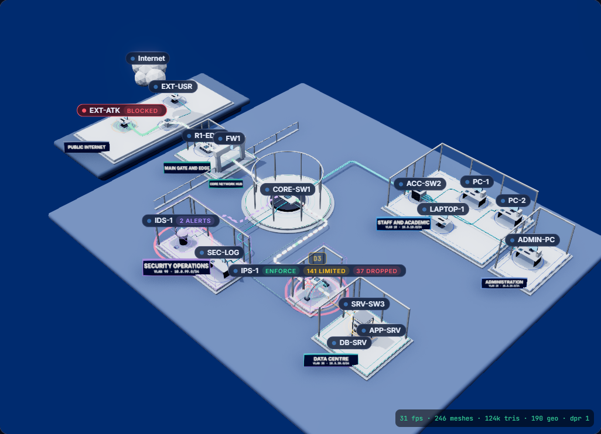 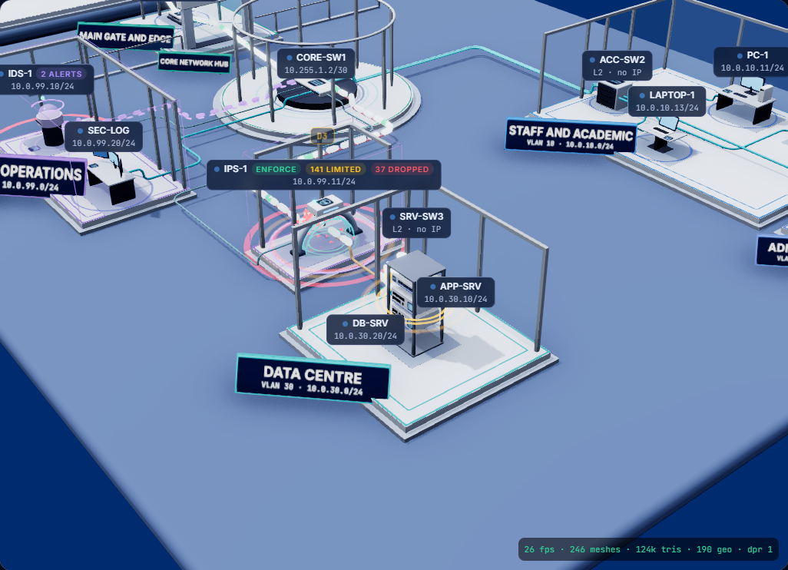 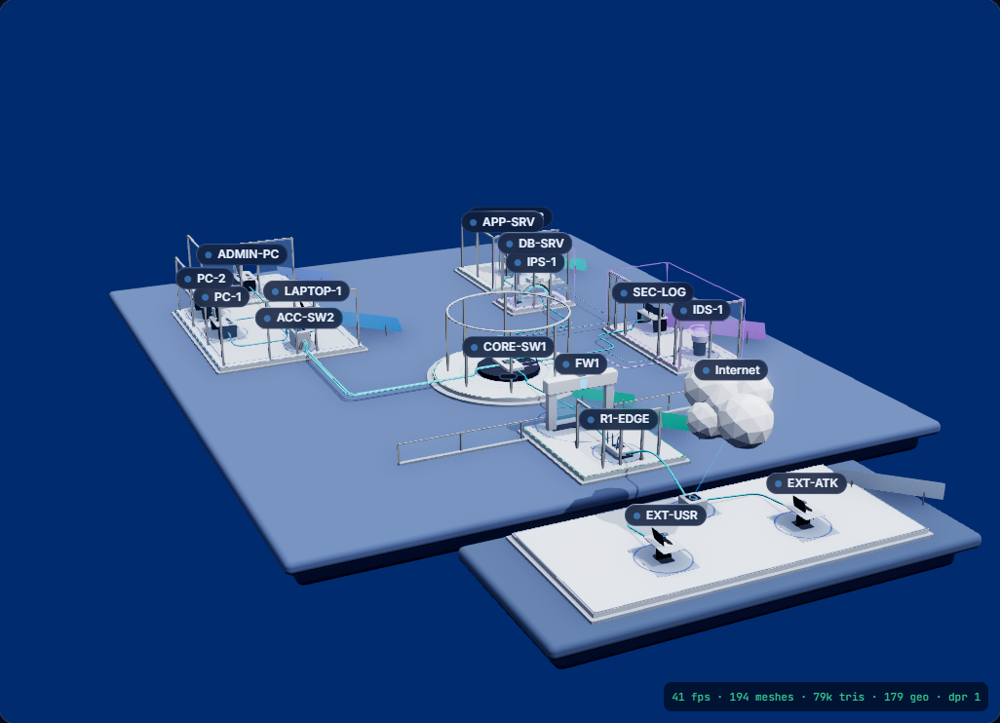 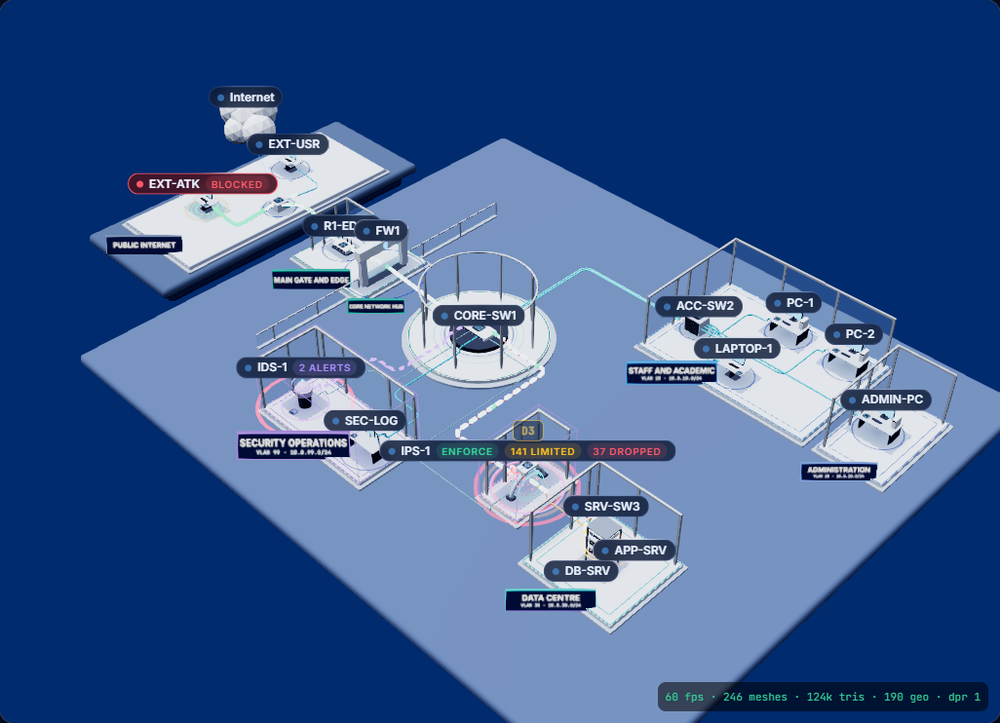
