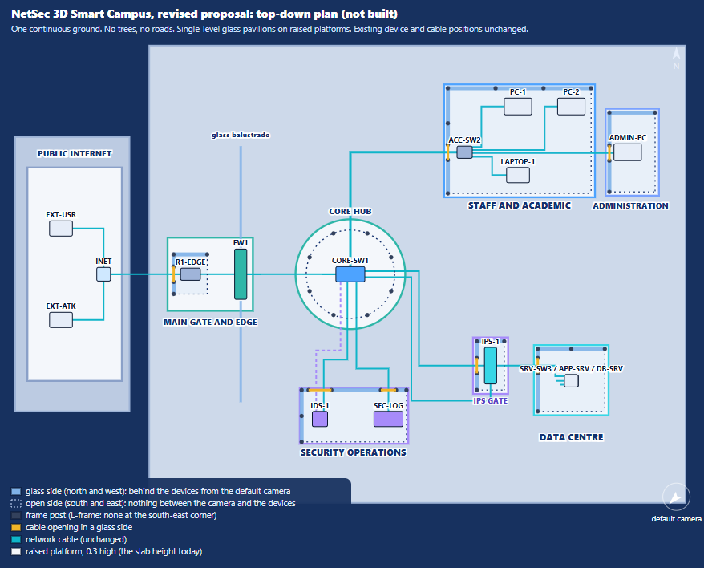
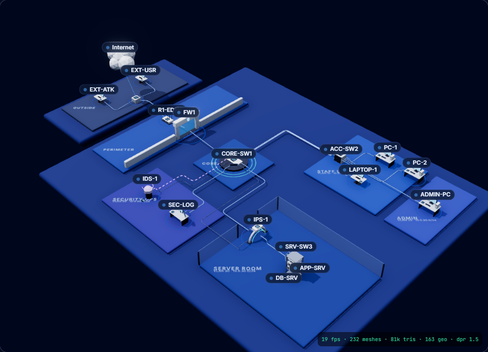
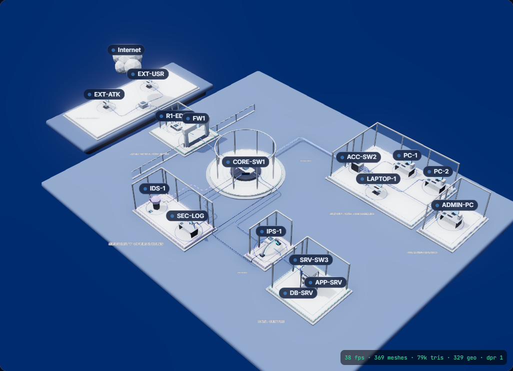
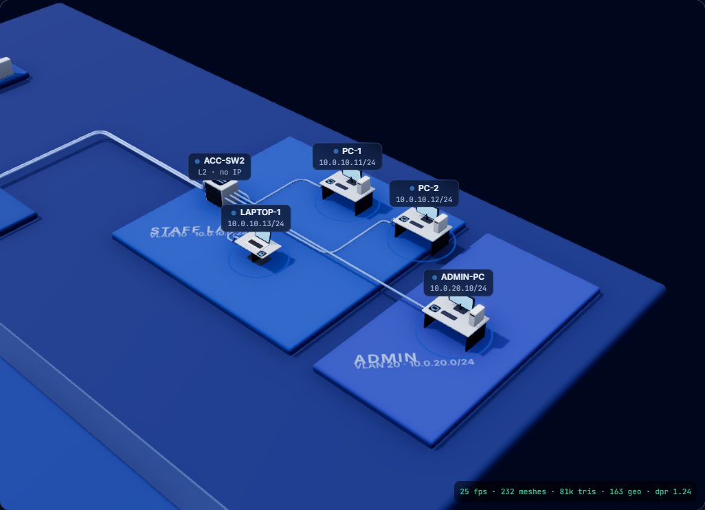
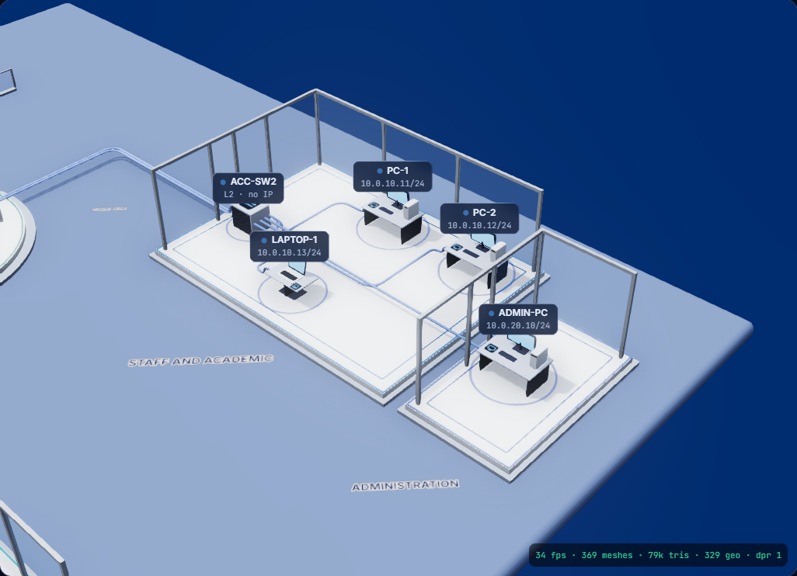
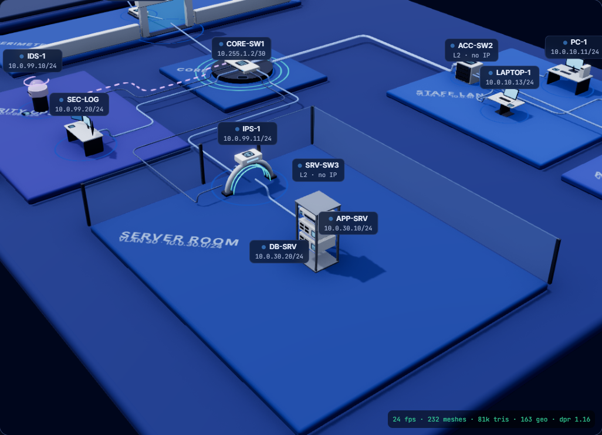
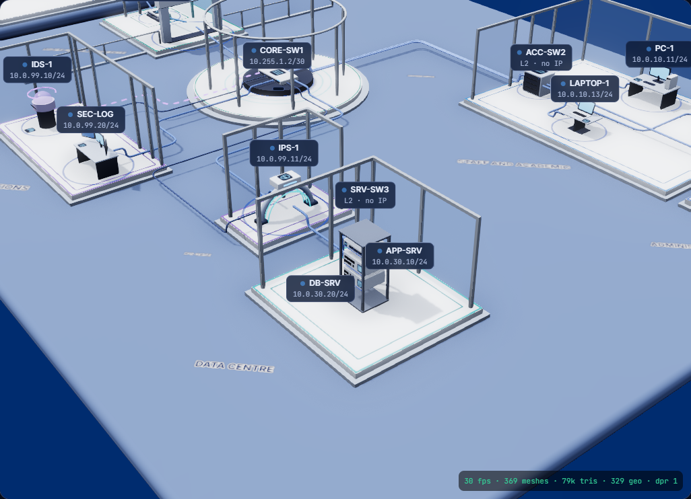
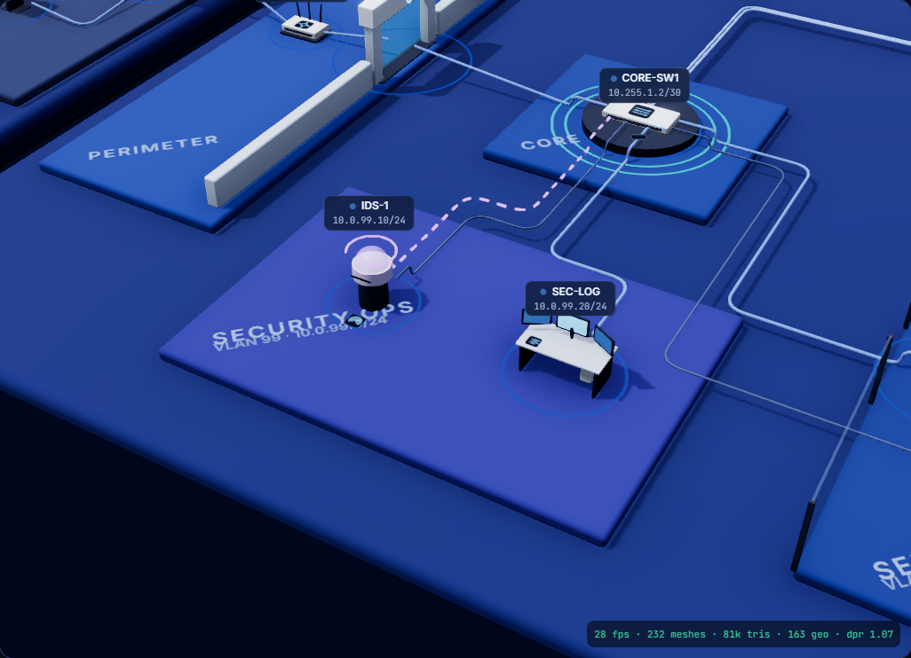
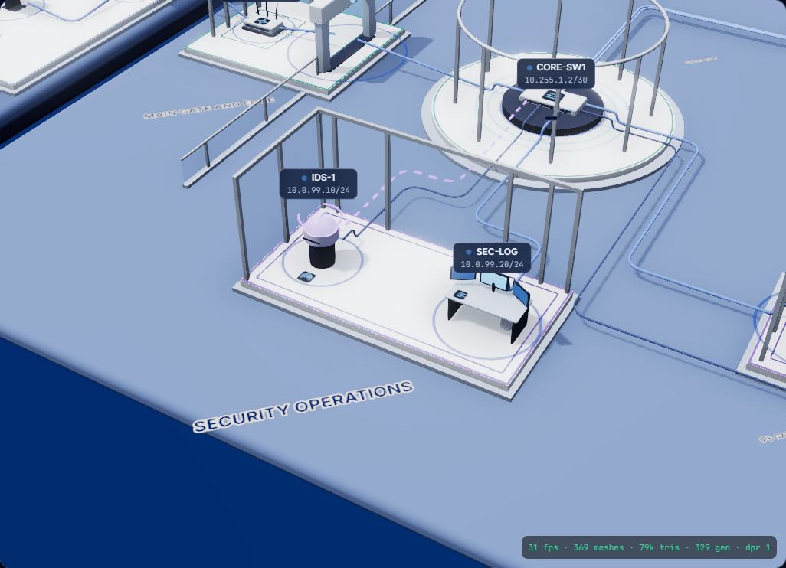

# Smart Campus design proposal, phase C1 (revision 2)

> **Status: a proposal. Nothing in the application has been changed.** This replaces the first proposal, which you rejected
> (multi-storey towers, roads, parking, trees, opaque buildings). Every picture below is either a plan generated from the real
> layout code, or the **real application renderer** with the proposed structures overlaid in a throwaway browser session.

## 0. What changed, and what I need you to decide

| Rejected in the first proposal | Revised proposal |
|---|---|
| Trees, shrubs, street lights, benches | **None.** No vegetation and no decorative objects. |
| Grey roads, lane markings, parking | **None.** One continuous ground plane. |
| Faculty tower (4 floors), Administration wing (3 floors), plant building, annex | **None.** Every structure is single-level, 3.0 high (the edge router's, 2.2), and compact (largest 65 square units). |
| Opaque walls and solid roofs | Glass on the two sides **behind** the devices, **open** on the two sides facing the camera, **no roof**. |
| Campus plate enlarged | **Unchanged** (35.2 x 30.0). Nothing needs more room. |

Six decisions are yours (details in section 9). My recommendations are first:

1. **IPS-1** goes in the Security Operations zone, as your table says, in its own small glass gate pavilion where it physically stands.
2. **Ground**: a steel-blue ground with near-white raised platforms (the palette in the pictures).
3. **Platform height**: keep 0.3 (what the zone slabs already have), so no device or cable moves.
4. Keep the **off-campus island** separate, to show the Internet boundary.
5. Replace the opaque perimeter wall with a **low glass balustrade**.
6. Zone captions become **raised signs**, not flat ground text (the prototype shows why).

## 1. Revised top-down campus layout

One continuous ground. Six pavilions, a round core pavilion, a gate court and the off-campus platform, all on raised platforms.
Existing device and cable positions are untouched. Solid blue lines are glass, dotted lines are open sides, yellow marks are
cable openings. The default camera looks from the south-east (bottom right of the plan).

| Zone (selectable) | Structure | Frame footprint (x0, z0, x1, z1) | Size | Holds |
|---|---|---|---|---|
| Staff and Academic | Pavilion | 6.4, -12.2, 15.8, -5.3 | 9.4 x 6.9 | PC-1, PC-2, LAPTOP-1, ACC-SW2 |
| Administration | Pavilion | 17.0, -10.6, 20.0, -5.4 | 3.0 x 5.2 | ADMIN-PC |
| Data Centre | Pavilion | 12.3, 4.9, 16.7, 9.0 | 4.4 x 4.1 | APP-SRV, DB-SRV, SRV-SW3 |
| Security Operations | Operations pavilion | -3.2, 7.6, 3.68, 11.0 | 6.9 x 3.4 | IDS-1, SEC-LOG |
| Security Operations | **IPS gate pavilion** | 8.3, 4.4, 10.1, 7.6 | 1.8 x 3.2 | IPS-1 |
| Core Network Hub | Round pavilion | centre 0, 0; platform radius 3.6; 8 columns at radius 2.9 | | CORE-SW1 |
| Main Gate and Edge | Gate court (platform) plus edge router pavilion (2.2 high) | court -12.0, -2.4, -6.4, 2.4 | | R1-EDGE, FW1 (the gate model itself) |
| Public Internet (off campus) | Island platform (today's slab, restyled) | -21.2, -7, -15, 7 | | INET, EXT-USR, EXT-ATK |

All 17 existing nodes are in exactly one zone, and the four zones you listed hold exactly the devices in your table (checked by
`generate.mjs`). Spacing: no two platforms overlap, the closest pair (Staff and Administration) is 0.70 apart, and the core hub is
2.8 from its nearest neighbour, so there is room for cables and packets between buildings.

## 2. The 3D structure design

Each pavilion has the same anatomy, so they read as one architectural family:

1. **Raised platform.** A pale slab 0.3 high (the height the zone slabs have today) on a slightly larger, lower plinth step 0.12 high, with a
   thin accent-coloured edge light in the zone's colour, and a fine light line inset on the floor.
2. **L-shaped steel frame.** Slim posts (0.1 square) at the north-west, north-east and south-west corners and at most 3.2 apart along the glass sides, and a
   ring beam along the **north and west** sides only. **There is no post at the south-east corner and no beam on the south and east
   sides**: that is the side the default camera looks through.
3. **Glass panels on the north and west sides**, full height, cut at every cable opening and framed by two slim posts there.
4. **Open south and east sides.** Nothing between the camera and the devices.
5. **No roof.** The ring beam on two sides is all that is overhead.

Special cases: the **core hub** is a round platform with eight columns and a thin ring beam, open all round. The **IPS gate pavilion** is
a small version of the same design around the IPS arch, with a violet edge light (the sensor colour), so it reads as part of
Security Operations while standing at the data centre's door. The **perimeter wall** becomes a 0.9 high glass balustrade on a plinth
with the same steel posts and rail.

## 3. Material and transparency strategy

| Part | Material | Why |
|---|---|---|
| Ground | Matte, steel blue `#6b82ad` (island `#5d749f`) | Contrast for the pale platforms and glass; not dark; not an asphalt grey |
| Platform top, plinth | Matte near-white `#f1f5fb`, `#b9c7dc` | Reads as a raised pad; devices (clay) stay distinct from it |
| Frame | Steel, roughness 0.35, metalness 0.5 | The architectural line |
| Glass | The scene's existing glass material: blue tint `#9cc8ff`, **opacity 0.20**, `depthWrite` off, one pane per wall | One layer only, ever (below) |
| Edge and floor lights | Zone accent colour, **below the bloom threshold** (colour x 0.9 and x 0.55) | Controlled lighting, no glow |
| Selected zone | Accent edge x 2 (above the bloom threshold, as selection is today) | The only place that blooms |

Rules that keep it transparent and cheap:

* **A line of sight crosses at most one glass pane**, because glass is only on the sides behind the devices and a ray from outside a convex pavilion enters it once. Measured:
  at the presets 40 of 41 views cross none and one crosses one; in a full orbit (1152 views) 87.1% cross none, 12.9% cross exactly one, **none cross two**.
* Glass and frames cast **no shadows** and are **skipped by the pointer** (they never steal a click). No new real-time shadows are added; the
  platforms cast as the zone slabs do today.
* No roof, so no overhead transparent layer. No new post-processing.
* All glass is one merged mesh and one material: the cost of transparency is a handful of quads.
* Colours stay at or below the bloom threshold except selection, so the light ground does not glow.

## 4. How every existing device stays visible

There is no roof, no solid wall, no floor over a device and no decoration; the only things that can stand between a camera and a
device are **thin frame members** (0.1 wide) and **glass**. Measured against the six camera presets and a full orbit
(`docs/design/campus-c1/generate.mjs`; each device is sampled at 18 points):

| Device | Zone | Structure | Preset views: least visible | Free orbit: mean visible |
|---|---|---|---|---|
| PC-1 | Staff and Academic | Staff pavilion | 100% | 95% |
| PC-2 | Staff and Academic | Staff pavilion | 83% (an Administration beam grazes it at one preset) | 96% |
| LAPTOP-1 | Staff and Academic | Staff pavilion | 100% | 100% |
| ACC-SW2 | Staff and Academic | Staff pavilion | 100% | 92% |
| ADMIN-PC | Administration | Administration pavilion | 100% | 94% |
| APP-SRV | Data Centre | Data Centre pavilion | 100% | 96% |
| DB-SRV | Data Centre | Data Centre pavilion | 100% | 95% |
| SRV-SW3 | Data Centre | Data Centre pavilion | 100% | 97% |
| IDS-1 | Security Operations | Operations pavilion | 100% | 92% |
| SEC-LOG | Security Operations | Operations pavilion | 100% | 97% |
| IPS-1 | Security Operations | IPS gate pavilion | 83% (the Data Centre's west beam crosses it at one preset) | 91% |
| CORE-SW1 | Core Network Hub | Core pavilion | 89% (a column stands in front at two presets) | 99% |
| R1-EDGE, FW1 | Main Gate and Edge | Edge pavilion, gate court | 100% | 91%, 100% |
| INET, EXT-USR, EXT-ATK | Public Internet | Island platform | 100% | 100% (INET is not sampled: it is the cloud) |

Of 41 preset views, 37 show the whole device and the other four show 83 to 89%. In a full orbit, the mean is 95.9% and **no view shows
less than half of a device**. The devices are also interactable: their invisible pick boxes are unchanged and, being inside the
platform's footprint, are the nearest thing to the pointer, so a click on a device still selects the device. A pavilion is selected by clicking its
platform or frame.

**Limits, stated plainly.** From some orbit angles a post or a neighbour's beam crosses a device. Nothing opaque exists to hide one
completely. These figures are line-of-sight geometry, not renders; the renders are the pictures below.

## 5. Zone interaction on glass pavilions

The interaction design from the first C1 stands, adapted:

* **Hover:** the platform's edge light brightens and the pointer changes; a small name tag appears. No animation.
* **Click:** the zone is selected: its edge lights and frame brighten, a zone panel lists its purpose and devices (and highlights them), and **other zones fade** (platform tone x 0.78, edge lights x 0.4). Nothing hides.
* **Double-click:** the camera moves to fit the zone's bounding box; a "Back to campus" control returns to the overview. Existing presets, keys and panels remain.
* **IPS-1** is listed under Security Operations; selecting that zone also lights the IPS gate pavilion. IPS-1's management interface is already in the Security VLAN 99 (10.0.99.11, reached over link L16 from the core), so the grouping matches the network.

## 6. Files that will need modification (in C2 to C4, after your approval)

| Area | Files | Change |
|---|---|---|
| New campus layer | `frontend/src/scene/campus/` (`campusLayout.js`, `CampusWorld.jsx`, `Platform.jsx`, `Pavilion.jsx`, `CorePavilion.jsx`, `Balustrade.jsx`, `ZoneSigns.jsx`, `campusMaterials.js`) | Structures, zones and the zone-to-device mapping as data; merged geometry per zone and material |
| Scene composition | `frontend/src/scene/NetworkWorld.jsx` | Render the campus layer instead of `ZoneSlabs`, `PerimeterWall`, `ServerPartition` |
| Old decor | `frontend/src/scene/environment/Environment.jsx` | Plates recoloured; slab, wall and partition components retired (kept in history) |
| Look | `scene/materials/materials.js`, `scene/palette.js`, `scene/Lighting.jsx` | Ground, platform and glass materials; background and fog colour |
| State (C3) | `frontend/src/state/store.js` and `scene/CameraRig.jsx` | `hoveredZoneId`, `selectedZoneId`, a zone camera request |
| UI (C3) | `features/simulation/` | A zone panel next to the device panel |
| Tests | `frontend/src/scene/campus/campusLayout.test.js` | The checks in `generate.mjs`, as Vitest: mapping, containment, spacing, cable and post clearance, openings |

**Not modified:** `scene/layout.js`, `ZONE_LAYOUT`, `NODE_LAYOUT`, `LINK_LAYOUT`, the topology, the backend, the playback and effects code, and
the device models. The logical zone rectangles stay as they are, so the existing layout tests (for example "every device stands on the
slab of its own zone") keep passing unchanged: the campus is a presentation layer on top of them.

## 7. Performance considerations

Baseline on the current `develop` (Intel UHD, S4 at its peak, 1904 x 985): **High 19.4 to 21.4 fps, Low 59.7 to 59.8 fps, 241 draw calls, 82,096 triangles**,
174 geometries, 54 textures (High), 33 MB JS heap. The RTX 4050 target is still unverified.

Plan, to be measured in C2 and held to these limits: **at most 35 more draw calls and 8,000 more triangles**; no new real-time shadow casters
except the merged platform tops (the zone slabs cast today); no new post-processing; one merged mesh per material per zone (an **estimate** of
about 60 draw calls for the whole campus layer, replacing about 35 for the old slabs, captions, wall and partition); 45 posts and 13 beams are
tiny boxes; zone signs as 8 small textured quads. If the Low preset falls below 55 fps on the Intel laptop, or High drops below the
baseline, the implementation does not proceed.

**The prototype's own numbers are not the estimate.** It adds 166 separate meshes (369 in all) because it is a throwaway overlay with
nothing merged; the implementation merges them. Its frame rate varied with the browser's adaptive pixel ratio and says nothing about the final cost.

## 8. Before and after, in the real renderer

Same camera, same lights, same device models, bloom and ambient occlusion. Left: today. Right: the proposal.

| Overview | Before | After |
|---|---|---|
| |  |  |

| Staff and Administration | Before | After |
|---|---|---|
| |  |  |

| Servers, IPS and core | Before | After |
|---|---|---|
| |  |  |

| Security Operations | Before | After |
|---|---|---|
| |  |  |

Packets still read inside the glass: the S4 flood at its peak (about 200 packets in flight), with the IPS-1 drop rings, its live badges and the
delivery ring at the rack ([servers close-up](campus-c1/prototype/after-packets-servers.png), [overview](campus-c1/prototype/after-packets-overview.png)).
The **Low preset** also works ([overview](campus-c1/prototype/after-low-overview.png)).

| | Before (today) | After (proposal) |
|---|---|---|
| Ground | Navy slabs on a navy plate, one tone | One continuous steel-blue ground; pale raised platforms with a stepped plinth |
| Structures | None, except a 1.7 high glass partition round the server room and an opaque 0.8 wall | Seven compact glass-and-steel pavilions and a gate court, single-level |
| Interior visibility | Everything open, but nothing frames a zone | Every device inside a frame, none hidden |
| Overhead | Nothing | Nothing (no roof) |
| Zone identity | Flat captions on dark slabs | Platform edge lights in zone colours and signs |
| Perimeter | Opaque wall | Low glass balustrade |
| Network | Cables and packets as today | Cables and packets exactly as today |

**Honest assessments from looking at it.** (1) It is a clear step towards a campus, but it is still an abstract, clean campus: the
pavilions are frames and glass, not photorealistic buildings; that follows from "transparent, single-level, devices visible". (2) The flat zone captions
are barely legible at the overview distance; signs need to be raised and larger. (3) Cables are pale blue over a blue-grey ground:
visible, but I would brighten them slightly in C2. (4) The Data Centre pavilion is deliberately roomy around one rack; it can shrink
further if you prefer.

## 9. Decisions for you

| # | Question | Recommendation | Alternative |
|---|---|---|---|
| D1 | IPS-1 stands at the data centre door, 4 units from the SOC. How is it "inside" Security Operations? | A small IPS gate pavilion, part of the Security Operations zone, where it stands. No device or cable moves. | Merge it into one larger Operations pavilion: that would need the platform to run from the SOC to the door and push the Data Centre east. |
| D2 | Ground tone | Steel blue `#6b82ad` with pale platforms | Deep navy ground (a darker, more dramatic look) |
| D3 | Platform height | 0.3, unchanged | 0.45: a more visible rise, but every device and cable height shifts with it (a larger C2) |
| D4 | The off-campus island | Keep it separate (the air gap is the WAN boundary) | Join it to the campus ground |
| D5 | The perimeter wall | Low glass balustrade | Remove it |
| D6 | Zone captions | Raised signs on each platform | Name tags only on hover |

## 10. Risks and testing

| Risk | Mitigation |
|---|---|
| Glass makes the scene look washed out or heavy | One pane deep at most (measured); opacity 0.20 tuned on the real renderer; Low preset checked |
| The light ground blooms | Colours held below the bloom threshold; checked on the real renderer in the pictures |
| Glass or frames steal clicks | Pointer events disabled on them; zone selection uses the platform |
| Device labels (HTML) over glass | Labels are already overlays; verified in the prototype |
| Cables lose contrast on the lighter ground | Palette tweak in C2 |
| Performance | Merged geometry, budget above, measured against the baseline before any merge |
| An existing layout test fails | The logical layout is untouched; the full suite runs before and after every phase |

Testing in C2: the unchanged suites (1068 backend, 287 frontend, 93 of 93 scenario checks, identical trace hashes, the build, the 20 split-origin
checks, the browser rehearsal), a new campus layout test, a browser check that all 17 devices are visible at each preset, console-error checks,
and frame rate, draw calls, triangles and WebGL resources against the baseline above on both presets.

## 11. How this was made, and its limits

* `docs/design/campus-c1/proposal.mjs` holds the proposal; `generate.mjs` imports the **real** layout, device footprints, cable routes and topology,
  runs the 15 checks (all pass), and writes `campus-plan.svg` and `proposal.json`; `render.mjs` makes the plan PNG.
* `prototype.mjs` drives the running app in Chrome, hooks three.js's developer hook, hides the old slabs, captions, wall and partition,
  adds the proposed objects from `proposal.json`, and captures the same presets before and after. It changes nothing in the app or the repository.
* Run them with `node docs/design/campus-c1/generate.mjs`, `node docs/design/campus-c1/render.mjs`, and (with the app in demo mode)
  `node docs/design/campus-c1/prototype.mjs --base http://127.0.0.1:8000`.
* **Not verified:** how any of this performs in the real implementation; the RTX 4050 target; anything on Linux or macOS. The visibility figures are geometric
  estimates from sampled lines of sight.
